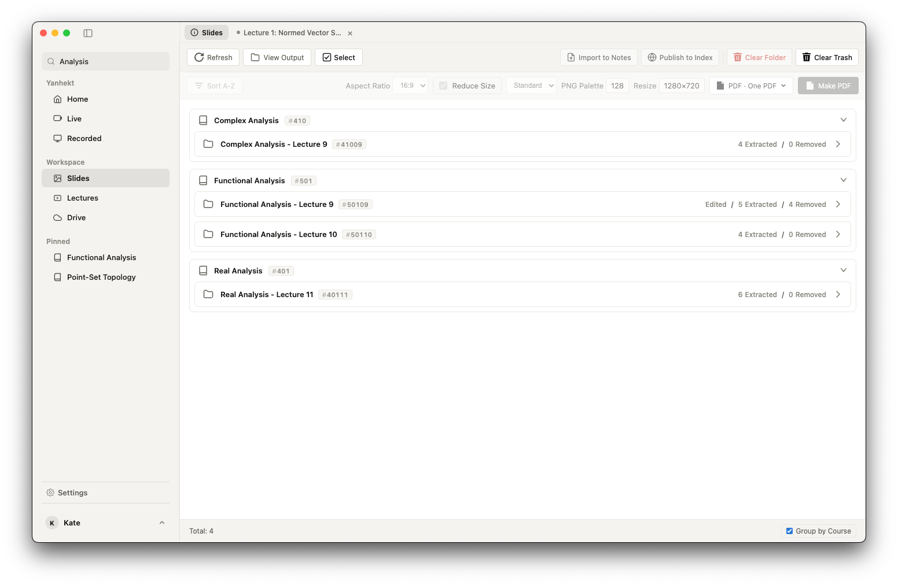
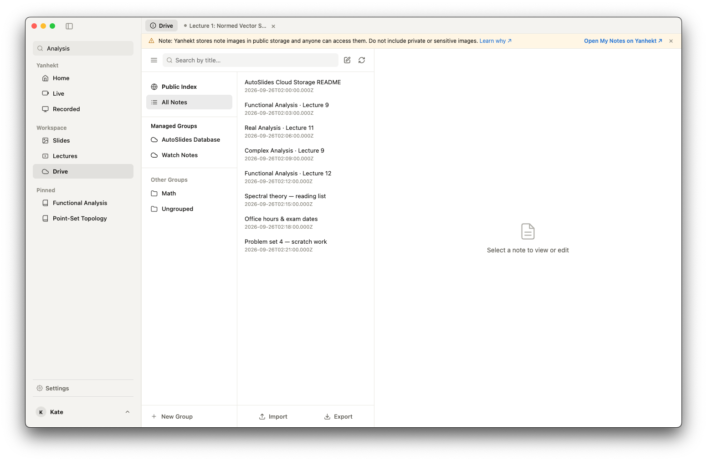
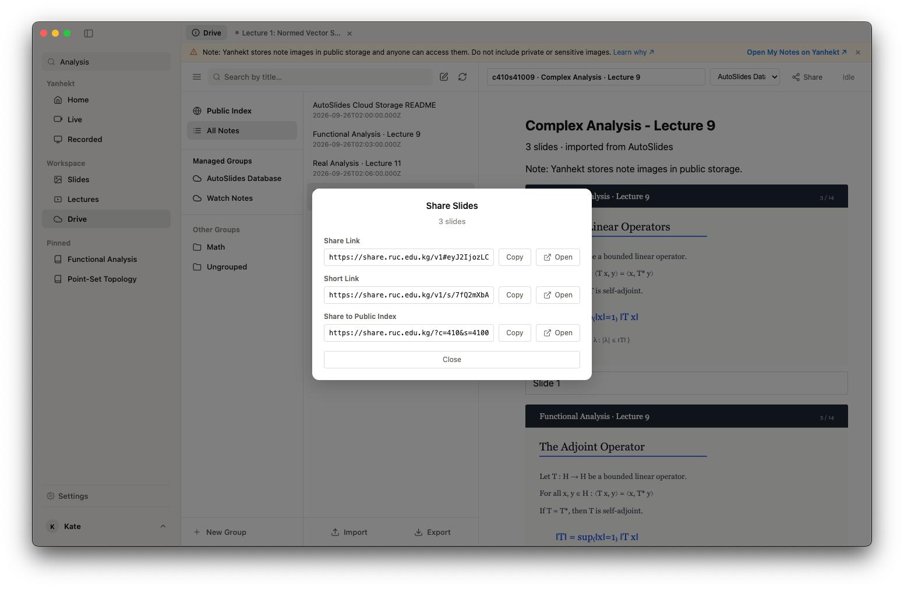
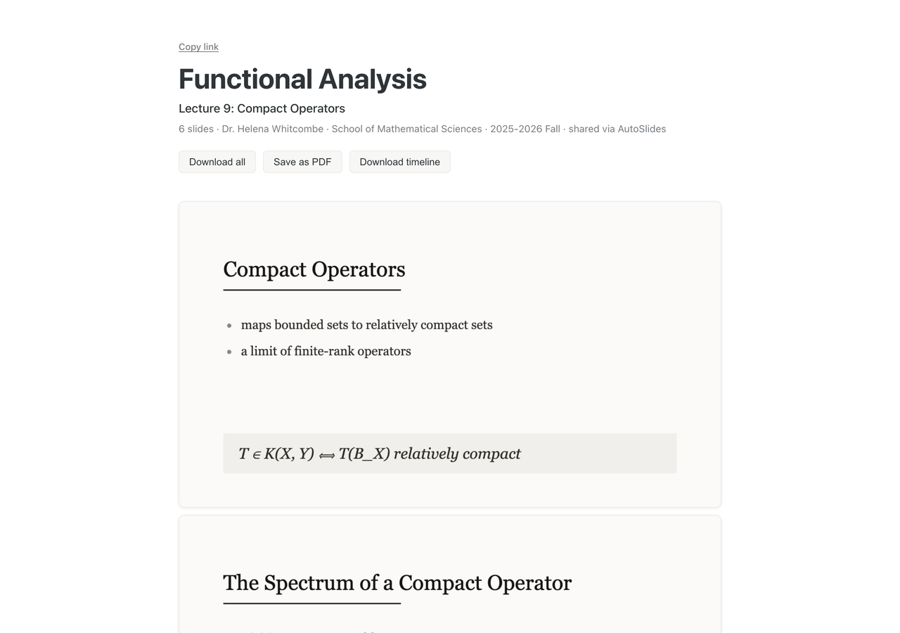

<div align="center">

  

  # AutoSlides Index

  **幻灯片分享页｜一条链接分享整套幻灯片｜延河课堂课程索引（重建中）**

  <p>
    
    
    
  </p>

  <p>
    <a href="https://share.ruc.edu.kg">🌐 在线使用</a> •
    <a href="https://share.ruc.edu.kg/demo/v1/">🎮 在线演示</a> •
    <a href="#-完整流程">🧭 完整流程</a> •
    <a href="../README.md">💻 桌面版</a>
  </p>

</div>

---

> [!CAUTION]
> **Disclaimer**: This tool is intended strictly for personal study; users assume full legal responsibility for ensuring their usage complies with all applicable copyright laws and platform regulations. Terms and Conditions apply.
> <br> **免责声明**：本工具严格仅供个人学习之用；用户须自行承担全部法律责任，确保其使用符合所有适用的版权法及平台规例。受条款及细则约束。
>
> <p align="center"><a href="https://learn.ruc.edu.kg/terms">Read full Terms and Conditions / 按此查阅完整条款及细则</a></p>
>
> This tool is NOT an official application of, and is NOT affiliated with, associated with, endorsed by, or in any way connected to Beijing Institute of Technology (BIT), or any of their subsidiaries or affiliates. All product and company names are trademarks™ or registered® trademarks of their respective holders.
> <br> 本工具**并非**北京理工大学（BIT）的官方应用程式，亦与其或其任何附属机构或关联方无任何关联、联系、获其认可或以任何方式相关。所有产品及公司名称均为其各自持有人的商标™或注册®商标。

## ✨ 这是什么

[share.ruc.edu.kg](https://share.ruc.edu.kg) 👈 是 [AutoSlides](../README.md) 的分享端：

- **幻灯片分享页**（`/v1/…`）——把一条链接里的整套课件排成一页长文档，可以整包下载、存成 PDF，也可以下载幻灯片时间轴。打开不需要登录。
- **课程索引**（重建中）——旧的公共索引已经停用。新的索引按课程名、教师、课程唯一编码查找延河课堂的历年课程，数据来自 [`indexer/`](../indexer/) 爬取的课程目录。目前只有接口：[`docs/api.md`](docs/api.md)。

静态演示：[share.ruc.edu.kg/demo/v1/](https://share.ruc.edu.kg/demo/v1/) 👈

<br>

## 🧭 完整流程

一句话概括：

> 用 **AutoSlides** 自动提取录播课程的幻灯片 → 作为课件笔记上传到**个人云存储** → 通过**链接**分享给别人。

<br>

### 1. 提取幻灯片

在 AutoSlides [桌面版](../README.md) 或[网页版](../web/README.md) 里播放一节录播课，幻灯片会一边看一边提取出来，重复画面、板书之外的画面和编辑模式截图由后处理和 AI 过滤掉。提取结果在 `工作区 > 课程幻灯片` 里按课程节次成册，可以恢复、删除、裁剪。

<p align="center">
  
</p>

<br>

---

### 2. 上传到云存储

`工作区 > 云存储` 底部的 `导入` 把本地 `slides_*` 文件夹做成一条云端笔记，存进延河课堂你自己的笔记里（自动管理的 `AutoSlides 数据库` 分组）。笔记末尾会附带这套课件的 `metadata.json` 与 `timeline.json`，所以之后无论是分享还是还原成本地文件夹，信息都不会丢。

<p align="center">
  
</p>

> [!WARNING]
> 延河课堂把笔记中的图片存放在公开对象存储中，任何人拿到地址都能访问。请不要在笔记里放入私人或敏感图片——分享链接建立在这一点之上。

<br>

---

### 3. 分享

打开一条笔记，右上角 `分享`：

- **分享链接**——一条长链接，课程号、课节号和每张图片的短哈希都编码在 `#` 后面。任何人打开都能看到这套幻灯片，无需登录；链接本身就是全部数据，服务器不留记录。
- **短链接**——点 `获取短链接` 把上面那条压成 `…/v1/s/xxxxxxxxxx`，方便发给别人。短链接会记回笔记里，下次分享复用同一条。

如果 `设置 > 云端 > 嵌入幻灯片时间轴` 开着（默认开启），且这套课件有 `timeline.json`，链接里还会带上一份压缩过的时间轴——对方就能知道每张幻灯片对应录像里的哪一刻。

<p align="center">
  
</p>

<br>

---

### 4. 别人打开链接看到的页面

分享链接指向幻灯片分享页：整套课件排成一页长文档，顶部是课程、课节、老师、学院和学期——这些名称是打开时向延河课堂查的，不在链接里。

三个操作：`Download all` 打包成 zip（带 `timeline.json`），`Save as PDF` 逐页合成 PDF，`Download timeline` 单独下载时间轴（链接里没有时间轴时不可用）。点任意一张可以放大。

<p align="center">
  
</p>

<br>

## 🛠 开发

本目录是一个 Cloudflare Worker，外加两个 React + Vite 静态前端：根路径 `/` 的课程索引站（`site/`），和 v1 幻灯片分享页。Worker 负责 v1 的 KV 短链接与延河课堂元数据代理，以及读取 D1 `yanhekt-index` 的课程索引接口（`src/api/`，见 [`docs/api.md`](docs/api.md)）。索引站只读这个接口，浏览器不直接请求延河课堂；课程页的上课时间、教室与录像信息由 Worker 经服务绑定 `WEB`（`../web` 的 `/api/yanhekt` 代理）实时读取；`/` 与 `/assets/*` 由静态资源层直接返回，`/search`、`/course/{id}` 由 Worker 返回同一个页面。

```sh
npm install
cp wrangler.example.jsonc wrangler.jsonc   # 填入你自己的 KV / D1 id 与自定义域名
npm run build        # 构建 dist/（索引站）、dist/v1（分享页）与 dist/demo/v1（演示站）
npm run dev          # vite dev，只跑分享页
npm run dev:site     # vite dev，只跑索引站；/api 转发到本地 wrangler dev（8787），或 INDEX_API=…
npm run demo         # vite dev，只跑分享页演示站
npm run preview      # wrangler dev：Worker + 静态资源 + 本地 KV/D1
npm run screenshots  # Playwright 驱动演示站重新生成 docs/viewer.png（需要 magick）
npm run typecheck && npm test
npm run deploy       # 构建并发布
```

首次部署还需要：

```sh
wrangler kv namespace create SHARE_KV                 # v1 短链接
wrangler d1 create yanhekt-index --location apac      # 课程索引，由 indexer/ 写入（见 indexer/README.md）
```

---

<div align="center">
<p>Copyright © 2026 bit-admin.</p>
<p>
<a href="https://github.com/bit-admin/Yanhekt-AutoSlides">GitHub</a> •
<a href="mailto:info@ruc.edu.kg">Email</a> •
<a href="https://it.ruc.edu.kg/docs">Docs</a>
</p>
</div>
